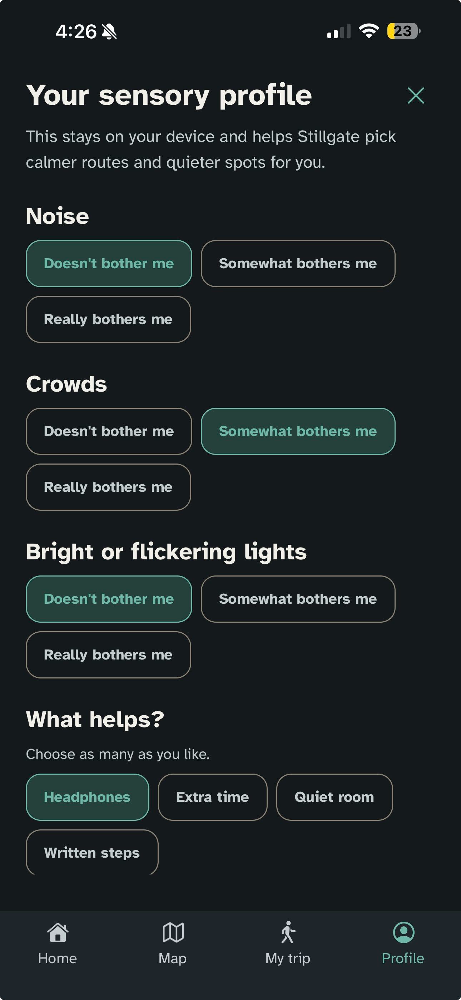
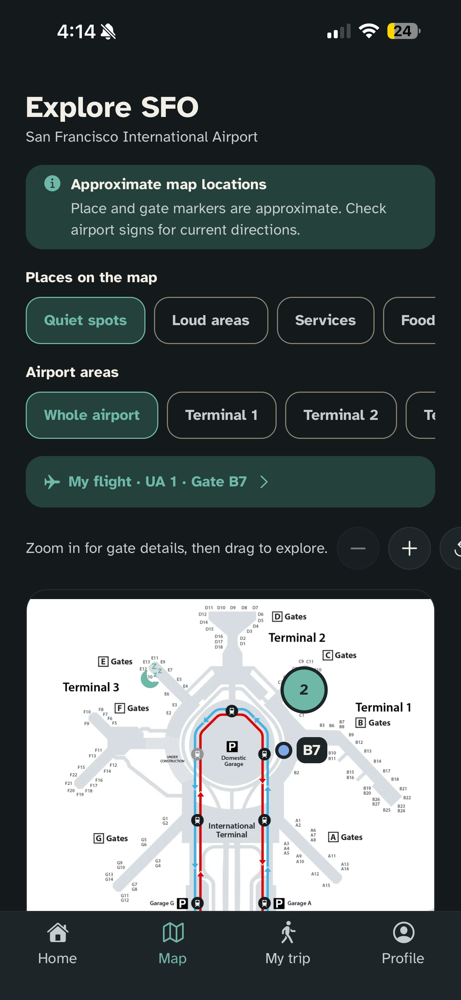
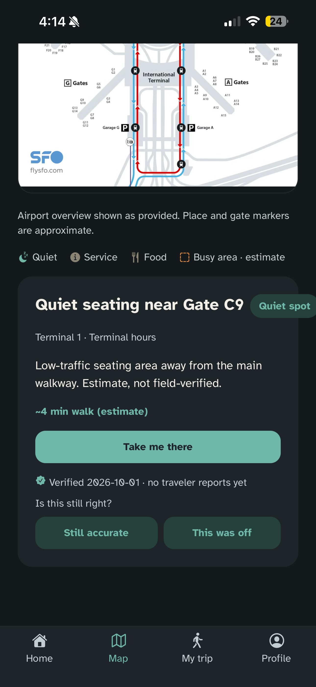
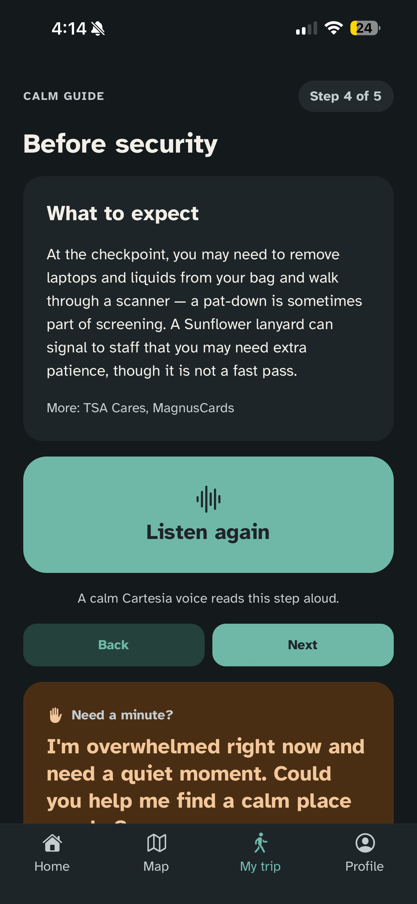
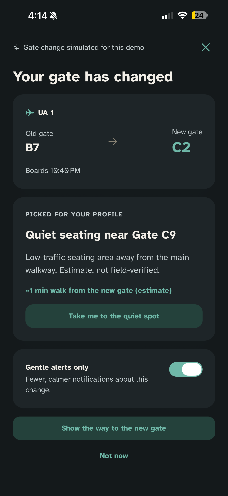
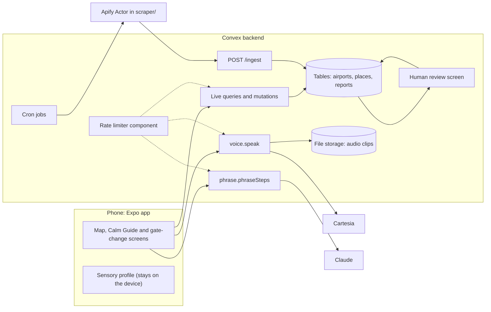

# Stillgate
Airports can be loud, crowded, and unpredictable, which can make travel harder for neurodivergent and sensory-sensitive people. A 2025 research study from Trinity college with a sample of over 300 families found that for most people, stress drops after security, but for neurodivergent travelers, it stays high the whole trip. Some airports have sensory rooms and support programs, but they’re scattered. Stillgate aims to fill that gap. Ultimate goal is one website and one app for every airport. That’s the gap Stillgate fills.

Stillgate is a sensory-aware airport companion designed for autistic and other neurodivergent travelers. It helps travelers prepare for an airport visit, find sensory-relevant places and services, and follow calm, step-by-step trip guidance.

This is a hackathon prototype, not an airline or airport-operated service. Flight examples and gate changes are simulated. Check the labels and source/verification details in the app; walking times and some airport information are estimates or sample data.

## What the prototype does

- **Personal sensory profile:** travelers can record how noise, crowds and lighting affect them, choose what helps, and set the amount of guide detail. The profile is saved on the device and is not stored in Convex; the gate-change screen sends its settings with each request for quiet-place steps.
- **Airport map and places:** the app shows airport places such as sensory rooms, quiet areas and services. Reviewed place records are fetched from Convex, cached on the device, and combined with clearly identified bundled sample data when needed.
- **Accuracy reports:** travelers can mark a place "Still accurate" or "This was off". Counts update live, each device counts once per place per day, and a "wrong" report on a scraped place sends it back to the review queue instead of changing it automatically.
- **Trip and Calm Guide:** the app builds a step-by-step plan from the selected flight, trip details, profile and airport information. Rules in the app determine the facts and recommendations.
- **Gate-change demo:** the demo can simulate a gate change and show a next step. It is not a live gate-change alert from an airline.
- **Spoken guide:** the app sends a guide transcript to the Convex `voice:speak` action. The backend calls Cartesia, stores the generated MP3 in Convex file storage, and returns a URL for the app's `expo-audio` player. Repeated text with the same voice can reuse a stored clip.
- **Calm phrasing:** on the gate-change screen, an Anthropic Claude action can reword the rule-generated quiet-place steps. The action checks that gates, numbers and caveat words such as "estimate" are preserved and falls back to the original text if it cannot safely rewrite them. Claude does not choose airport facts or routes.
- **Airport-data review pipeline:** an Apify Actor collects information from configured airport webpages and sends candidate updates to Convex for human review. Scraped changes are drafts; they do not become traveler-facing approved information automatically.
- **Flight lookup:** when configured, the app can request flight data through the Convex/Apify backend. Labeled sample flights are available for the demo and local development.

## Prototype screenshots

| Sensory profile | Airport map | Quiet-place details |
| --- | --- | --- |
|  |  |  |

| Calm Guide | Simulated gate change |
| --- | --- |
|  |  |

## Technology

| Area | Technology | Role |
| --- | --- | --- |
| Mobile app | React Native, Expo SDK 58, Expo Router, TypeScript | Screens and mobile navigation |
| Audio playback | `expo-audio` | Plays generated guide audio in the app |
| Backend and storage | Convex | Airport records, live queries, actions, HTTP endpoints, cron jobs, file storage for generated audio, and the rate-limiter component (details below) |
| Spoken audio | Cartesia | Converts guide text into speech on the backend |
| Step phrasing | Anthropic Claude | Rephrases the gate-change screen's rule-generated steps, with fact checks |
| Data collection | Apify Actor, Crawlee and Playwright | Collects configured airport-page content for review |
| Local profile storage | AsyncStorage | Keeps sensory preferences on the device |

## Sponsor technologies

| Technology | How Stillgate uses it | Where to look |
| --- | --- | --- |
| **Convex** | One TypeScript backend: **live queries** (report counts, the review queue and gate-change steps update without a refresh), **HTTP endpoints** (`/ingest` for the scraper, `/importAirport` for data imports), **cron jobs** (weekly scrape, daily check for stale verifications), **file storage** (generated speech clips, cached by text and voice), and the **rate-limiter component** guarding the public functions that spend credits or accept writes. | `convex/` (`schema.ts`, `http.ts`, `crons.ts`, `voice.ts`, `limits.ts`, `reports.ts`) |
| **Cartesia** | Reads each Calm Guide step aloud in a calm voice. The API key stays on the backend; the app only receives a URL to a stored clip. | `convex/voice.ts`, `src/data/guide-audio-provider.ts` |
| **Anthropic Claude** | Rewords the gate-change screen's rule-generated quiet-place steps in calmer language. It never chooses facts: the backend checks that every number, gate and caveat ("estimate", "verified", "unknown") survives, and otherwise returns the original text. The app shows a caption when Claude's wording is on screen. | `convex/phrase.ts`, `src/app/gate-change.tsx` |
| **Apify** | An Actor (built for this event) reads official airport accessibility pages and posts candidate places to Convex as drafts. Convex also starts it weekly and uses Apify for the optional live flight lookup. A person approves each draft before travelers see it. | `scraper/`, `convex/scrape.ts`, `convex/ingest.ts`, `convex/review.ts`, `convex/flights.ts` |

## Architecture



The sensory profile never leaves the phone except as part of a single request (for example, asking for gate-change steps). Scraped data reaches travelers only after a person approves it in the review screen. The rate limiter guards the expensive or write-heavy public functions: Claude rewording, speech generation and accuracy reports.

## Run the mobile app

Requirements: Node.js and npm.

From the repository root:

```bash
npm install
npm start
```

The Expo development server will show options for opening the app. For the backend-connected experience, start the team's Convex development deployment in a second terminal:

```bash
npx convex dev
```

Convex setup, deployment selection, data seeding, environment variables and backend commands are documented in [BACKEND.md](BACKEND.md). Backend API keys belong in Convex environment variables, never in the mobile app, README, or committed `.env` files. The mobile app can use bundled sample data when Convex is not configured or unavailable.

In Windows PowerShell, if script execution blocks `npm` or `npx`, use the command shims instead (for example, `npm.cmd start` and `npx.cmd convex dev`).

## Useful project commands

```bash
npm run lint       # Lint the Expo project
npm run validate   # Validate shared airport JSON data against its schema
npm run schema     # Regenerate the JSON schema from shared/schema.ts
```

## Project structure

```text
stillgate/
├── src/                         # Expo / React Native mobile app
│   ├── app/                     # Expo Router screens and navigation
│   │   ├── (tabs)/              # Home, Map, My trip (Calm Guide) and Profile tabs
│   │   ├── flight-lookup.tsx    # Flight search screen
│   │   ├── gate-change.tsx      # Gate-change demo flow
│   │   └── review.tsx           # Place review screen
│   ├── components/              # Reusable interface components
│   ├── contexts/                # Shared React context
│   ├── data/                    # Airport, flight, profile and narration logic
│   │   └── mock/                # Bundled sample airports and flights
│   ├── hooks/                   # Reusable app hooks, including audio playback
│   ├── lib/                     # App helpers and Convex client
│   └── constants/               # Theme and app constants
├── convex/                      # Convex backend
│   ├── airports.ts              # Airport records and lookup
│   ├── flights.ts               # Optional live flight lookup
│   ├── gateChange.ts            # Gate-change and nearby-place logic
│   ├── voice.ts                 # Cartesia speech generation and audio storage
│   ├── phrase.ts                # Guarded Claude guide rephrasing
│   ├── scrape.ts, ingest.ts     # Scrape scheduling and incoming data
│   ├── review.ts, reports.ts    # Human review and accuracy reports
│   ├── schema.ts                # Convex database schema
│   └── _generated/              # Generated Convex types and API files
├── shared/
│   ├── data/                    # Sample airport records
│   ├── schema.ts                # Shared airport data types
│   └── airport.schema.json      # JSON validation schema
├── scraper/
│   └── src/                     # Apify Actor and extraction tests
├── voice-test/                  # Standalone Cartesia speech experiment
├── assets/                      # App images and other static assets
├── docs/                        # Project design notes and specifications
├── scripts/                     # Repository utility scripts
├── app.json                     # Expo app configuration
├── package.json                 # Mobile app dependencies and commands
├── BACKEND.md                   # Backend setup and function reference
└── README.md
```


## Data, privacy and prototype boundaries

- The sensory profile is stored locally on the device. The backend receives only information needed for a specific request; the profile is not stored in a Convex profile table.
- The detailed map layouts currently supported by the app are SFO and CHS. Convex-seeded airport records may have narrower coverage; see [BACKEND.md](BACKEND.md).
- Scraped information is a candidate for review, not proof that a room or service is currently available. Use the source and verification information shown in the app.
- Walk times and some flight or gate scenarios are estimates or demo data. The app does not provide guaranteed indoor navigation or live airline gate-change notifications.
- The prototype should not be treated as emergency, security, visa, or official airport advice. Follow airport, airline and government instructions.
- The expensive public functions (Claude rewording, speech generation and accuracy reports) are rate limited, but there are no user accounts, so the limits are global or per place, and the anonymous device id used for reports can be reset. Before a public launch, add sign-in, moderation, data verification checks and cost monitoring.

